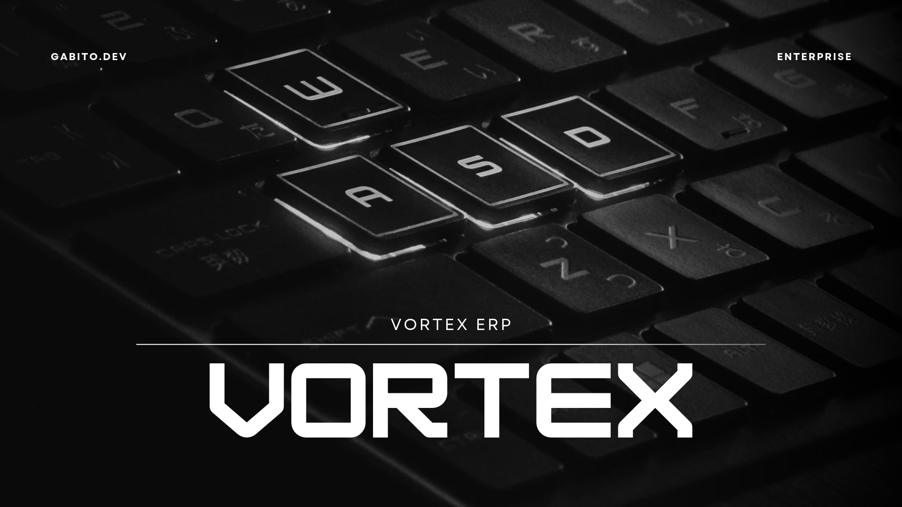

# Vortex ERP



Gestión administrativa de la suite **Vortex** (**ERP, CRM, WMS, POS**): libre y de código abierto (AGPL-3.0), hecho
en Perú para LATAM y el mundo. Es una app **.NET MAUI Blazor Hybrid** para Windows, Android, iOS y macOS que funciona
sin conexión y se integra con el resto de la suite a través del hub [vortex-api](https://github.com/ArcGabito/vortex-api).

## Qué hace

- **Pedidos de venta**: creados en el ERP, recibidos del CRM o del WMS, o generados a partir de las cotizaciones
  aceptadas en el CRM. El WMS los despacha y aquí se ve el envío.
- **Comprobantes**: facturas (clientes con RUC) y boletas, con desglose de IGV y lo exonerado aparte, emitidos desde un
  pedido o desde una venta de caja del POS. Cada equipo tiene su propia serie (`F3F0-000045`).
- **Cobranzas**: cobros parciales o totales por transferencia, efectivo, tarjeta, Yape/Plin o cheque; cuentas por
  cobrar por cliente con lo vencido primero.
- **Compras**: órdenes de compra a proveedores que el WMS recibe; se cierran solas con sus recepciones.
- **Inventario valorizado**: el stock que lleva el WMS, valorizado al último costo de compra.
- **Panel**: ingresos del mes y de los últimos 6 meses, por cobrar, vencido, pendientes de facturar e inventario.

## Cómo encaja en la suite

| Con | El ERP… |
|---|---|
| Hub | Inicia sesión (sin usuarios propios) y sincroniza artículos, sedes, clientes, proveedores y datos de la empresa. |
| CRM | Recibe `quote.accepted`, `deal.won` y `order.created`; publica `invoice.issued` y `payment.received` para el historial del cliente. |
| WMS | Publica `order.created` y `purchase_order.created`; recibe `shipment.dispatched`, `goods.received` y `stock.adjusted`. |
| POS | Recibe `sale.completed`, `sale.voided` y `sale.returned` como ingresos; publica `invoice.issued` con el comprobante de la venta. |

Ninguno es obligatorio: sin CRM los pedidos se crean aquí, sin WMS no hay stock que valorizar y sin POS no hay ventas
de caja. El detalle está en [docs/INTEGRACION.md](docs/INTEGRACION.md).

## Empezar

Requisitos: [.NET SDK 10](https://dotnet.microsoft.com/download) con el workload de MAUI
(`dotnet workload install maui`) y el hub corriendo en local (Docker).

```bash
git clone https://github.com/ArcGabito/vortex-api ~/vortex-api
cd ~/vortex-api && docker compose up -d && dotnet run --project src/VortexApi --launch-profile http   # http://localhost:5299

git clone https://github.com/ArcGabito/vortex-erp && cd vortex-erp
scripts/pack-sdk.sh                                                  # SDK del hub -> packages/vortex-sdk
dotnet test tests/VortexErp.Core.Tests                               # pruebas (no necesitan el hub)
dotnet run --project src/VortexErp -f net10.0-windows10.0.19041.0    # app en Windows (también -f net10.0-android)
```

En Windows con el hub dentro de WSL, empaqueta el SDK con `./scripts/pack-sdk.ps1`. Usuario demo:
`luis@vortex.local` / `Suite-Local-2026!` (en Debug, **Usar cuenta demo** en el login). La clave de sistema de
desarrollo es `vxp_erp_dev_key_change_me` y se cambia desde el login (**Servidor → Cambiar**).

## Estructura

```
src/
├── VortexErp.Core/    Pedidos, comprobantes, cobranzas, compras, reportes, sincronización y eventos (sin MAUI)
└── VortexErp/         App MAUI Blazor Hybrid: pantallas, sesión con el hub y sistema de diseño
tests/
└── VortexErp.Core.Tests/
```

## Contribuir

Lee [CONTRIBUTING.md](CONTRIBUTING.md). `main` está protegida: los cambios entran por pull request con el CI en verde.
Para vulnerabilidades, [SECURITY.md](SECURITY.md).

## Licencia

[GNU AGPL-3.0](LICENSE.md). Si ofreces Vortex ERP como servicio en red, debes publicar tus cambios.
